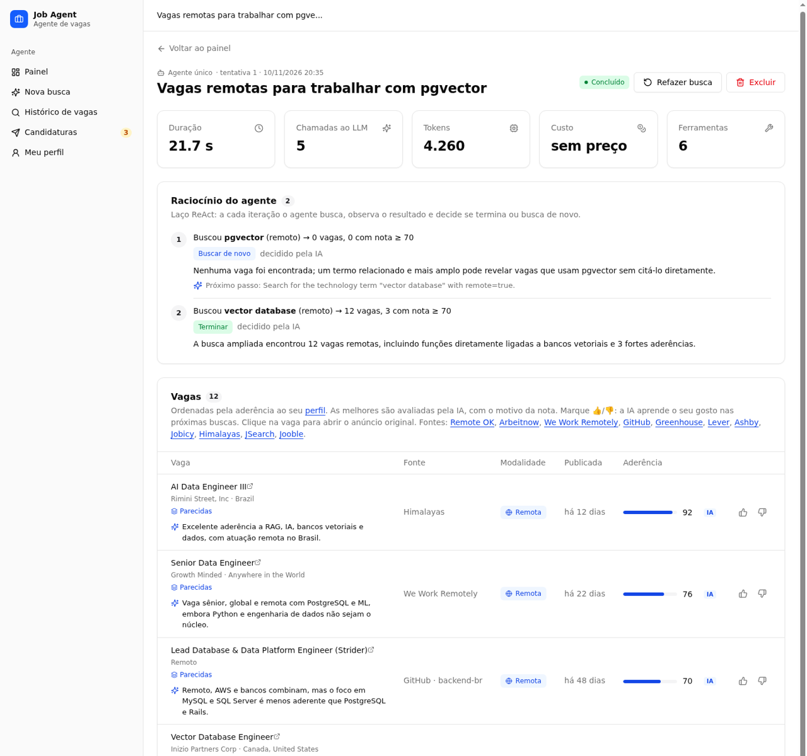
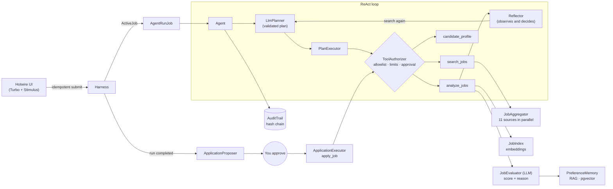
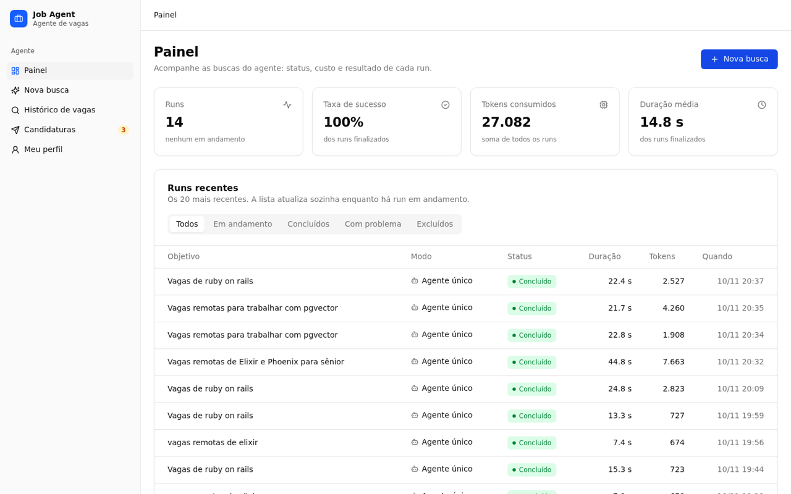
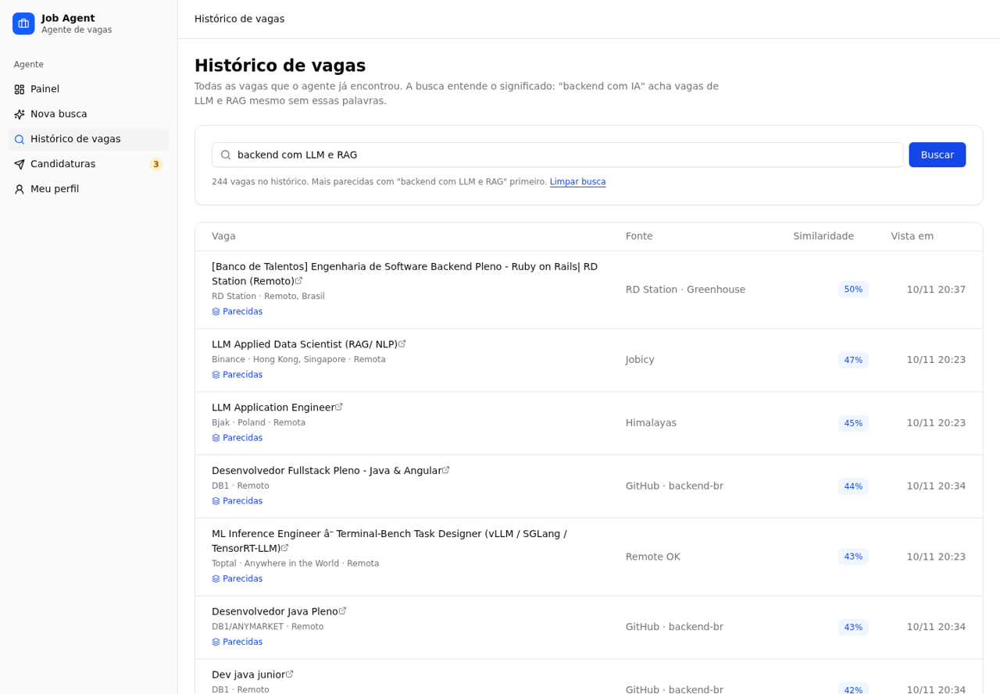
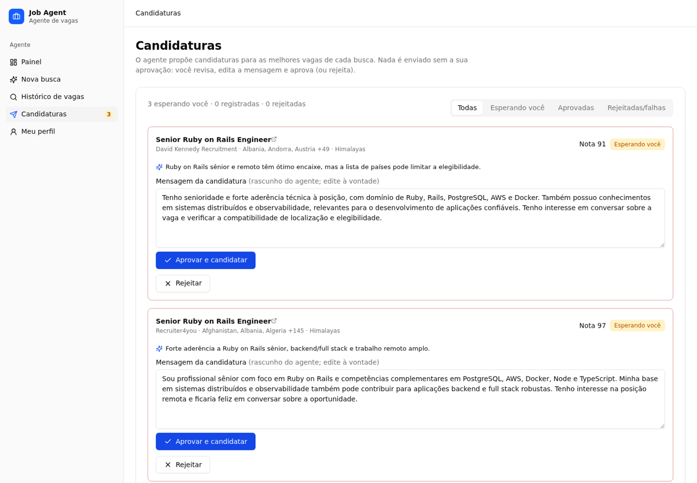
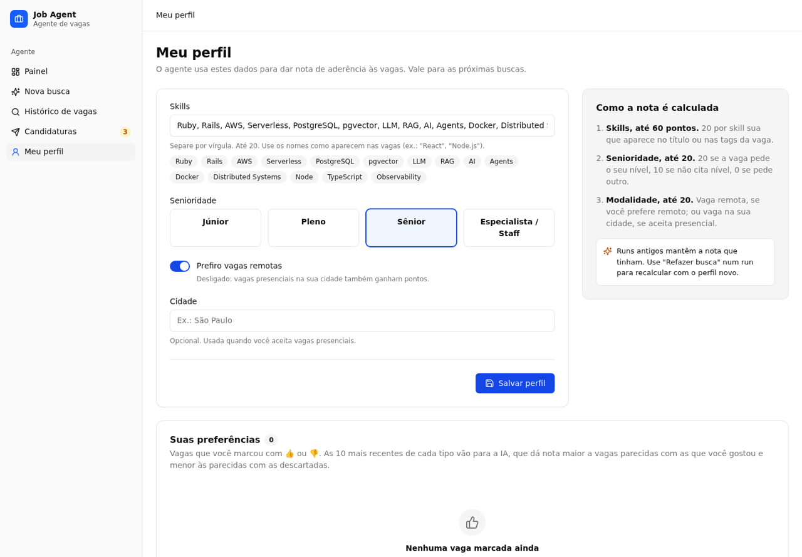

# Job Agent

[Português](README.md) · **English**

<p>
  
  
  
  
  
  
</p>

**An AI agent that searches for jobs, scores each one against your profile, learns from your feedback and proposes applications, which are only recorded after you approve them.**

A personal project for studying **production-grade AI agent engineering**, written in Ruby on Rails 8. The focus is not just "calling an LLM", but everything that makes an agent **reliable**: validated planning, bounded tools, idempotency, tamper-evident auditing, token budgets, quality evals, memory, RAG, looped reasoning and human approval for side-effecting actions.

> The user interface and the code comments are in Brazilian Portuguese; identifiers, LLM prompts and this document are in English.

<p align="center">
  
</p>

> In the screenshot: the agent searched for "pgvector" and found nothing. It **observed** the result, **decided** to search for "vector database", found 12 jobs and stopped. Each job shows the AI score and the reason behind it.

---

## Contents

- [What it does](#what-it-does)
- [Architecture](#architecture)
- [Agent concepts, one by one](#agent-concepts-one-by-one)
- [Security](#security)
- [Reliability and cost](#reliability-and-cost)
- [Job sources](#job-sources)
- [Screens](#screens)
- [Project structure](#project-structure)
- [Running it](#running-it)
- [Tests and quality](#tests-and-quality)
- [What testing against the real LLM taught us](#what-testing-against-the-real-llm-taught-us)
- [Known limitations](#known-limitations)
- [Next steps](#next-steps)

---

## What it does

1. You describe what you are looking for ("Remote Rails jobs with AI") and pick a mode: **single agent**, **pipeline** (researcher → analyst) or **supervisor** (an LLM splits the work among specialists, in parallel).
2. The agent **plans** which tools to call. The plan is validated before anything runs.
3. It **searches 11 real sources** at once: LinkedIn, Indeed and Gupy through JSearch, jobs straight from companies such as Nubank and Stone, Brazilian developer communities on GitHub, and more.
4. An LLM **scores each job** against your profile and explains the score, using your 👍/👎 history **retrieved by similarity** (RAG).
5. If the results are weak, it **reflects and searches again** with a different strategy (ReAct loop).
6. For the best jobs, it **proposes applications** with a drafted message. Nothing is recorded until you **approve the exact action**.

Everything runs in the background, the screen updates on its own as the run progresses, and every decision lands in a hash-chained audit trail.

---

## Architecture



**Core ideas**

- **The LLM decides, the code executes.** The planner returns JSON in a strict schema. The executor only runs registered tools with validated arguments. No instruction in the prompt, not even a successful injection, changes what can be executed.
- **The LLM does not see the data.** The planner only gets references (`{"$ref": "search"}`) to tool results, never the values. The LLMs that do need to read jobs (the evaluator and the Reflector) **have no tools** and only return structured, validated output.
- **Everything is bounded:** steps per plan, calls per tool, execution time, tokens and cost per run, loop iterations.
- **AI features are extras, not dependencies.** If the evaluator, the embeddings or the Reflector fail, the agent falls back to simpler behavior and the run carries on.

---

## Agent concepts, one by one

| Concept | How it shows up here | Where it lives |
|---|---|---|
| **Tool planning** | The LLM builds a DAG of steps with dependencies and references between results. The plan is validated (known tools, no cycles, declared references) and repaired by feeding the error back to the LLM | `LlmPlanner`, `Plan`, `PlanningRetryPolicy` |
| **Controlled execution** | Retry with backoff for transient errors only, per-tool timeouts, step and time budgets | `PlanExecutor`, `Executor`, `RetryPolicy` |
| **Multi-agent** | A fixed pipeline (researcher → analyst) and a supervisor that delegates to specialists in parallel waves. Agents hand data to each other by reference | `MultiAgentPipeline`, `Supervisor`, `DelegationExecutor` |
| **LLM as a judge** | A 0–100 score with a reason, in a single call for up to 12 jobs; falls back to a rule-based score on failure | `JobEvaluator`, `AnalyzeJobsTool` |
| **Long-term memory** | 👍/👎 on jobs become preferences the evaluator takes into account | `JobFeedback`, `CandidateProfileTool` |
| **RAG** | Embeddings of jobs and feedback stored in Postgres (pgvector, HNSW index). The evaluator gets **the feedback most similar to the jobs being scored**, not the most recent. **Hybrid** semantic search (vector + keywords) and "similar jobs" | `JobIndex`, `PreferenceMemory`, `EmbeddingClient` |
| **Looped reasoning (ReAct)** | Act, observe, reflect, repeat: the Reflector reads a summary of the iteration and decides to finish or search again, with guidance for the planner. Deterministic rules avoid unnecessary calls | `Reflector`, `IterationObservation`, `Agent` |
| **Human in the loop** | The agent proposes applications; you edit and approve. The approval is bound to **the fingerprint of the exact action** (job + message) | `ApplicationProposer`, `ProposalApprovalGate`, `ApplicationExecutor` |
| **Quality evals** | A dataset of cases, graders for outcome, tool use and efficiency, an LLM judge and a regression gate against a baseline | `evals/`, `JobSearch::Evals` |

---

## Security

The agent handles **text nobody controls**: the objective typed in, job ads from 11 sources and LLM output. Defense is layered, and **the real barrier sits outside the LLM**.

- **Per-role allowlist (least privilege).** The search agent cannot even see the application tool. Only the `APPLIER` role has it, and only with approval.
- **Approval of the exact action.** The side-effecting tool (`apply_job`) only runs if there is a human approval with **the same fingerprint** of its arguments. If the message changes after approval, execution is blocked (`ApprovalRequiredError`). There is a test for it.
- **Untrusted text is delimited and sanitized.** Invisible and control characters are stripped, length is capped and the text goes inside `<untrusted_input>`, with look-alike tags neutralized in the content.
- **An injection detector** on the objective and an **attack corpus** in the tests (`spec/fixtures/security/injection_attempts.yml`).
- **A test with a "compromised LLM"** that returns whatever plan the attacker wants: the barriers outside the LLM must hold on their own (`spec/security/defense_in_depth_spec.rb`).
- **Hash-chained, append-only audit trail:** every authorization (allowed or denied), reflection and human decision is written **before** the action. Tampering with an event breaks the chain, and the UI flags it ("cadeia violada no evento N", chain broken at event N).
- **External links are `http(s)` only:** a job ad cannot become an `href="javascript:..."`.
- **Secrets:** keys only come from environment variables, are sent in headers (never in the URL when the API allows it) and are kept out of caches and logs.
- **Fail-closed UI:** without configured credentials it refuses all access instead of opening up.

---

## Reliability and cost

- **Durable runs** (`AgentRun`): a queue, *claim* with a **lease** and heartbeat, recovery of runs whose worker died, up to 3 attempts, cancellation and deadline checked at every step.
- **Idempotency everywhere:** form submission (a double click is the same run), side-effecting operations (lease + fencing token, so a stale worker cannot overwrite another worker's result) and the application destination.
- **Nested deadlines:** scoring (18 s) has a shorter deadline than the tool (25 s), which is shorter than the plan (45 s). The inner layer gives up first and falls back, instead of the outer deadline killing the run.
- **Per-run budgets:** token and cost limits for the planner, the evaluator and the Reflector, each with its own.
- **Observability:** spans per run, plan, step, LLM call and iteration, with tokens, latency and cost per run (`run.metrics`), structured JSON logs and a sensitive-data filter.
- **Fault-tolerant sources:** each source has a timeout and a cache. A source that is down only produces a log warning; the search only fails if **all** of them fail.

---

## Job sources

All of them are used legitimately, through official APIs or public feeds, and **every job links to the original posting and credits its source**, as the terms ask. Scraping sites that forbid it (LinkedIn, Indeed, Gupy) was ruled out on purpose.

| Source | What it brings | Access |
|---|---|---|
| **JSearch** (Google for Jobs) | Brazil: LinkedIn, Indeed, Gupy, Catho, Glassdoor… | free key (RapidAPI) |
| **Jooble** | Worldwide aggregator | free key |
| **Greenhouse / Lever / Ashby** | Straight from companies: QuintoAndar, Stone, Inter, Nubank, EBANX, VTEX… (editable list in `config/job_companies.yml`) | public APIs |
| **GitHub** (backend-br, frontendbr) | Jobs from Brazilian developer communities | public API |
| **Remote OK · We Work Remotely · Himalayas · Jobicy · Arbeitnow** | Remote tech jobs | public feeds |

Each source is an adapter behind the same interface (`app/services/job_search/job_sources/`). The aggregator queries all of them in parallel, filters by technology (whole words: "Java" does not match "JavaScript"), removes duplicates across sources, drops postings older than 60 days and caps each source at 10 jobs.

---

## Screens

| | |
|---|---|
| **Dashboard**: indicators computed in the database and runs updating live<br> | **Job history**: search by meaning (hybrid)<br> |
| **Applications**: the agent proposes, you edit and approve<br> | **My profile**: skills, seniority and learned preferences<br> |

Light and dark themes (<a href="docs/screenshots/run-dark.png">example</a>), a responsive layout with no horizontal scrolling at 375 px, and inline lucide icons, with no JavaScript dependency beyond Turbo and Stimulus.

---

## Project structure

```text
app/
├── controllers/          runs, jobs, feedback, applications, profile
├── models/               AgentRun, AgentAuditEvent, JobPosting (vector), JobFeedback, JobApplication, CandidateProfile…
├── jobs/job_search/      agent runs, proposing and executing applications, embeddings, recovery
├── services/job_search/  the agent: planner, executor, tools, RAG, Reflector, audit, budgets, harness
│   ├── job_sources/      one adapter per job source (same interface)
│   └── evals/            datasets, graders and LLM judge
└── views/ · javascript/  Hotwire (Turbo Streams + Stimulus)
config/
├── job_companies.yml     companies queried on Greenhouse / Lever / Ashby
├── llm_pricing.yml       per-model prices, for cost in dollars
└── recurring.yml         recurring job that recovers stuck runs
evals/job_search.yml      quality evaluation cases
spec/                     958 examples: unit, security, concurrency, integration
```

---

## Running it

**Requirements:** Ruby 3.3.6, Docker (for Postgres with pgvector) and an OpenAI API key.

```bash
# 1. Postgres 17 with pgvector, on port 5437
docker volume create job_agent_pgdata
docker compose up -d

# 2. Dependencies and database
bundle install
export DB_HOST=127.0.0.1 DB_PORT=5437
bin/rails db:prepare

# 3. Variables (see the table below) and the server
export OPENAI_API_KEY=...            # required for the agent
export JOB_AGENT_WEB_USER=me JOB_AGENT_WEB_PASSWORD=a-password
bin/rails server
```

Open http://localhost:3000. In development, jobs run inside the server process (the `:async` adapter). In production the project uses **Solid Queue**, with a recurring job that recovers stuck runs.

**Environment variables**

| Variable | Purpose | Default |
|---|---|---|
| `OPENAI_API_KEY` | planner, evaluator, Reflector, embeddings, drafts | — |
| `JOB_AGENT_WEB_USER` / `JOB_AGENT_WEB_PASSWORD` | access to the UI (HTTP Basic, fail-closed) | — |
| `DB_HOST` / `DB_PORT` / `DB_USERNAME` / `DB_PASSWORD` | Postgres | `localhost` / `5432` / `postgres` / `postgres` |
| `DB_NAME` | production database name | `job_agent_production` |
| `JOB_CONCURRENCY` | Solid Queue processes in production | `1` |
| `JSEARCH_API_KEY` | enables JSearch (LinkedIn, Indeed, Gupy…) | off |
| `JSEARCH_COUNTRY` | country for JSearch queries | `br` |
| `JOOBLE_API_KEY` / `JOOBLE_LOCATION` | enables Jooble | off / `Brazil` |
| `GITHUB_TOKEN` | raises the GitHub API limit (60 → 5,000/h) | optional |
| `JOB_SOURCES` | picks the sources, e.g. `remote_ok,greenhouse,github_br` | all free ones |
| `LLM_JOB_EVALUATION` · `RAG_ENABLED` · `REACT_ENABLED` · `APPLICATION_PROPOSALS` · `LLM_APPLICATION_DRAFTS` | toggles each AI feature | `true` |

**Command line**

```bash
bin/rails "job_search:run[Remote Ruby jobs]"              # runs the agent directly in the terminal
bin/rails "job_search:pipeline[Remote Ruby jobs]"         # researcher → analyst team
bin/rails "job_search:submit[Remote Rails jobs,agent]"     # submits a run to the harness (INLINE=1 runs it right away)
bin/rails "job_search:status[RUN_ID]"                      # state of a run
bin/rails "job_search:cancel[RUN_ID]"                      # requests cancellation of a run
bin/rails "job_search:audit[RUN_ID]"                       # shows and verifies the audit chain
bin/rails "job_search:delegate[Remote Ruby and Rails jobs]" # supervisor delegating to specialists
bin/rails "job_search:eval[agent]"                         # evals against the real LLM (JUDGE=1 enables the judge)
bin/rails job_search:index_history                         # builds embeddings for the history
```

To see costs in dollars, fill in the model prices in `config/llm_pricing.yml`. Without them, tokens are still counted and the cost shows as "sem preço" (no price).

---

## Tests and quality

```bash
DB_HOST=127.0.0.1 DB_PORT=5437 bundle exec rspec    # 958 examples
bundle exec rubocop
bin/brakeman
```

Brakeman reports two warnings: Rails 8.0 reaching end of support (the upgrade is in the next steps) and a weak-confidence false positive in `ContextWindow`, where `estimator.count` counts text tokens and does not build SQL.

- **No test touches the network or OpenAI.** Sources use fixtures with trimmed real samples from each API, and the AI features are off in the test environment. The suite was verified running with a fake `OPENAI_API_KEY` in the environment: no test tries to use it.
- **Real pgvector in the tests**, with a fake deterministic embedder (bag of words), so similarity queries actually run in Postgres.
- **Security** specs (injection corpus, compromised LLM, secrets), **concurrency** specs (worker races, fencing tokens, leases) and end-to-end **integration** specs.
- The **evals** (`evals/job_search.yml`) measure quality against the real LLM and act as a regression gate against a baseline.

---

## What testing against the real LLM taught us

Every feature was also tested against the real API, and several design decisions came from problems that only showed up there:

- **The ReAct loop was wasting tokens.** For an objective outside the profile ("Elixir jobs" for a Rails profile), the agent found 21 relevant jobs with low scores, because **the score measures the profile, not the objective**. It kept searching until the limit (Erlang, then BEAM). The fix was a volume rule (15 jobs end the loop without calling the LLM) and a prompt that separates the two.
- **AI scoring was silently disappearing.** Once RAG joined the same time window, scoring started exceeding its 10 s deadline and fell back to the rule-based score without anyone noticing. The tell was the missing "reason" on the jobs. The deadlines were re-nested with slack, and the batch got smaller (12 jobs, shorter reason).
- **Vector search preferred language over topic.** "Backend com LLM e RAG", typed in Portuguese, ranked Java jobs written in Portuguese above LLM jobs. The fix was **hybrid search**: the vector brings candidates and keywords re-rank them. LLM and RAG jobs moved up from 7th and 13th place to 2nd and 3rd.
- **APIs change.** JSearch returned 404 on the endpoint documented everywhere: v5 uses `/search-v2` and a different response shape. Jooble only understands locations in English ("Brazil"; "Brasil" comes back empty) and mixes in ads that are not jobs, which are now filtered out.
- **Similarity-based memory works.** With 12 recent pieces of feedback about marketing jobs, recency-based memory would have sent only those to the LLM. Similarity retrieval ignored them and brought the feedback relevant to the jobs being scored.

---

## Known limitations

- **Applications are not sent to the job sites.** There is no public API for submitting applications to LinkedIn, Gupy and the others. "Apply" records the application in the app's tracker, with the approved message and the link to finish on the site. A real integration (for example, an ATS applications API) plugs in behind the same interface (`create_application`).
- **Single user.** Access is HTTP Basic, meant for personal use. For multiple users, the path would be Rails 8's authentication generator.
- **The score measures the profile**, not the search objective. This is a product choice, not a bug, but it shows when you search outside your field.
- **The pipeline and supervisor modes do not use the ReAct loop.** In those modes, coordination is done by the pipeline or the supervisor itself.

---

## Next steps

- [ ] Upgrade to Rails 8.1 (8.0 is out of support)
- [ ] Deploy with Kamal (`config/deploy.yml`) and a Solid Queue worker
- [ ] Fill in `config/llm_pricing.yml` for dollar costs
- [ ] A Postgres trigger to make the audit trail immutable at the database level too
- [ ] Application integration with a real ATS

---

**Stack:** Ruby 3.3 · Rails 8 · PostgreSQL 17 + pgvector · Solid Queue · Hotwire (Turbo, Stimulus) · OpenAI (Responses API with structured output, embeddings) · RSpec · RuboCop · Brakeman
