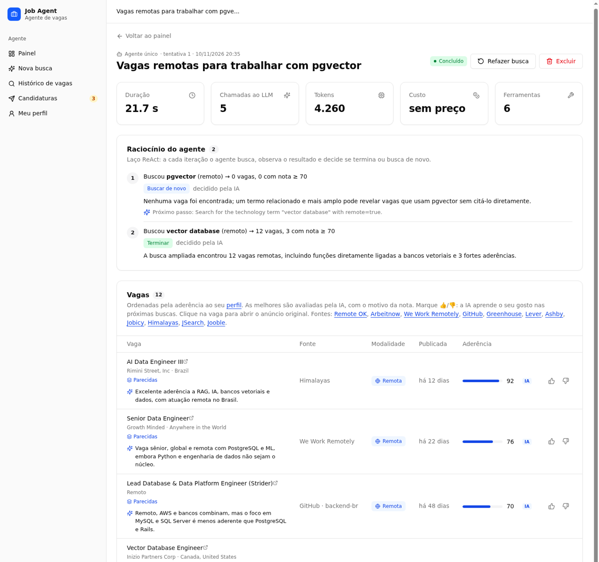
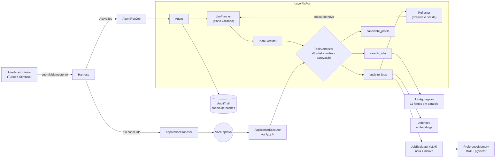
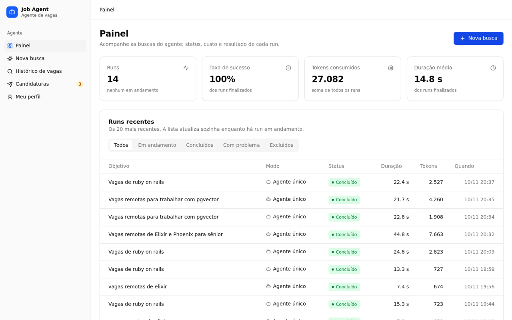
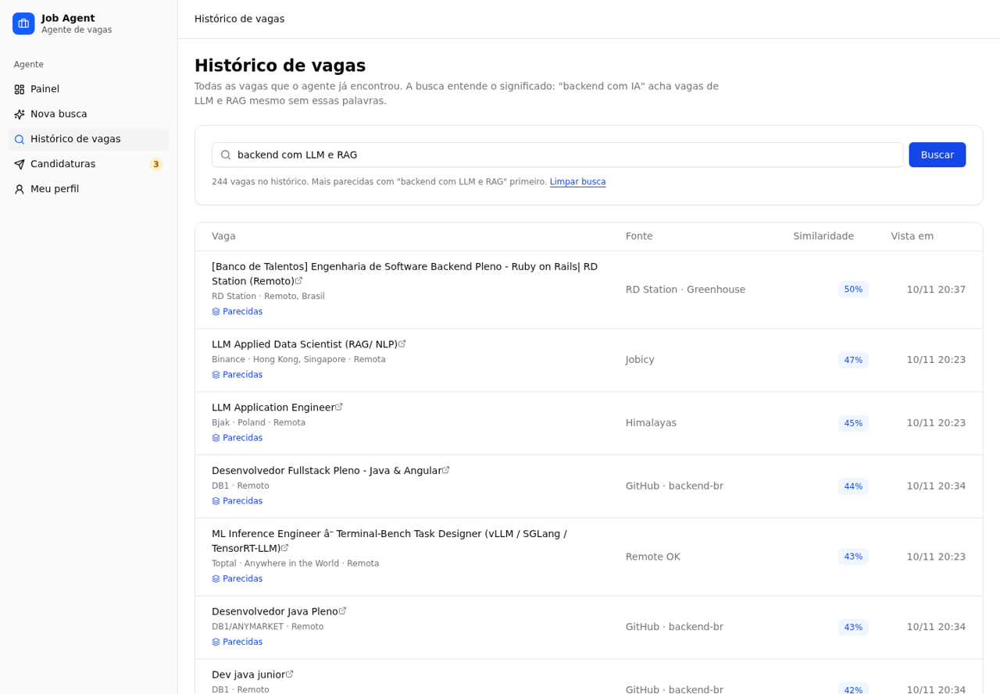
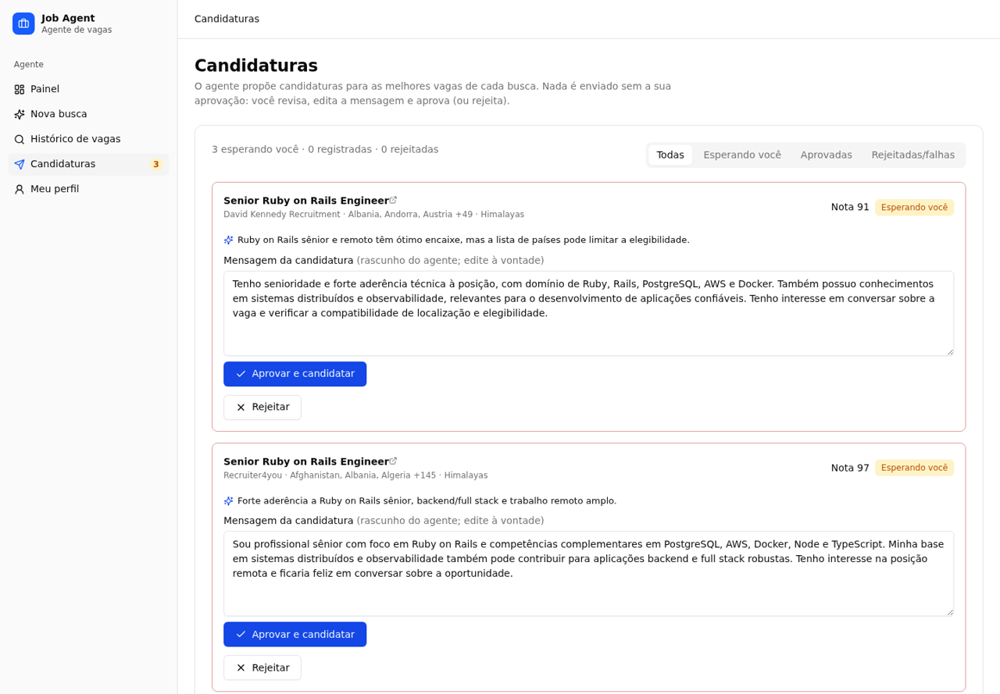
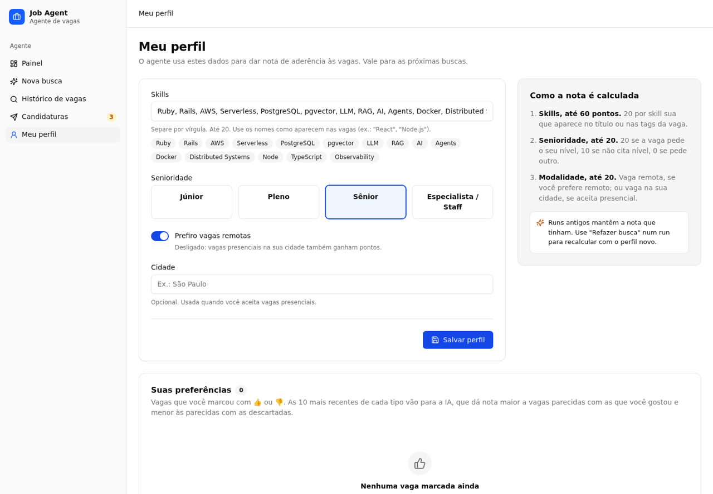

# Job Agent

**Um agente de IA que procura vagas de emprego, avalia cada uma contra o seu perfil, aprende com o seu feedback e propõe candidaturas, que só são registradas depois da sua aprovação.**

Projeto pessoal de estudo de **engenharia de agentes de IA em produção**, escrito em Ruby on Rails 8. O foco não é só "chamar um LLM", mas tudo o que torna um agente **confiável**: planejamento validado, ferramentas com limites, idempotência, auditoria à prova de adulteração, orçamento de tokens, avaliação de qualidade, memória, RAG, raciocínio em laço e aprovação humana para ações com efeito colateral.

<p align="center">
  
</p>

> Na imagem: o agente buscou "pgvector" e não achou nada. Ele **observou** o resultado, **decidiu** buscar "vector database", encontrou 12 vagas e parou. Cada vaga traz a nota da IA e o motivo.

---

## Sumário

- [O que ele faz](#o-que-ele-faz)
- [Arquitetura](#arquitetura)
- [Os conceitos de agente, um por um](#os-conceitos-de-agente-um-por-um)
- [Segurança](#segurança)
- [Confiabilidade e custo](#confiabilidade-e-custo)
- [Fontes de vagas](#fontes-de-vagas)
- [Telas](#telas)
- [Como rodar](#como-rodar)
- [Testes e qualidade](#testes-e-qualidade)
- [O que os testes com o LLM real ensinaram](#o-que-os-testes-com-o-llm-real-ensinaram)
- [Limitações conhecidas](#limitações-conhecidas)
- [Próximos passos](#próximos-passos)

---

## O que ele faz

1. Você descreve o que procura ("Vagas remotas de Rails com IA") e escolhe o modo: **agente único**, **pipeline** (pesquisador → analista) ou **supervisor** (um LLM divide o trabalho entre especialistas, em paralelo).
2. O agente **planeja** quais ferramentas chamar. O plano é validado antes de qualquer execução.
3. Ele **busca em 11 fontes reais** ao mesmo tempo: LinkedIn, Indeed e Gupy via JSearch, vagas direto de empresas como Nubank e Stone, comunidades brasileiras no GitHub e outras.
4. Um LLM **avalia cada vaga** contra o seu perfil e explica a nota, usando o seu histórico de 👍/👎 **recuperado por similaridade** (RAG).
5. Se o resultado for fraco, ele **reflete e busca de novo** com outra estratégia (laço ReAct).
6. Para as melhores vagas, ele **propõe candidaturas** com uma mensagem redigida. Nada é registrado sem você **aprovar a ação exata**.

Tudo roda em segundo plano, com o progresso atualizado em tempo real na tela, e cada decisão fica numa trilha de auditoria encadeada por hash.

---

## Arquitetura



**Ideias centrais**

- **O LLM decide, o código executa.** O planner devolve JSON num schema estrito. O executor só roda ferramentas registradas, com argumentos validados. Nenhuma instrução no prompt, nem uma injeção bem-sucedida, muda o que pode ser executado.
- **O LLM não vê os dados.** O planner recebe só referências (`{"$ref": "search"}`) aos resultados das ferramentas, nunca os valores. Os LLMs que precisam ler vagas (o avaliador e o Reflector) **não têm ferramentas** e devolvem só saída estruturada e validada.
- **Tudo tem limite:** passos por plano, chamadas por ferramenta, tempo de execução, tokens e custo por run, iterações do laço.
- **Recursos de IA são extras, não dependências.** Se o avaliador, os embeddings ou o Reflector falharem, o agente cai num comportamento mais simples e o run continua.

---

## Os conceitos de agente, um por um

| Conceito | Como aparece aqui | Onde está |
|---|---|---|
| **Planejamento com ferramentas** | O LLM monta um DAG de passos com dependências e referências entre resultados. O plano é validado (ferramentas existentes, sem ciclos, referências declaradas) e reparado com o erro devolvido ao LLM | `LlmPlanner`, `Plan`, `PlanningRetryPolicy` |
| **Execução controlada** | Retry com backoff só para erros transitórios, timeout por ferramenta, orçamento de passos e tempo | `PlanExecutor`, `Executor`, `RetryPolicy` |
| **Multiagente** | Pipeline fixo (pesquisador → analista) e supervisor que delega a especialistas em ondas paralelas. O repasse entre agentes é feito por referência | `MultiAgentPipeline`, `Supervisor`, `DelegationExecutor` |
| **LLM como avaliador** | Nota de 0 a 100 com o motivo, numa chamada para até 12 vagas; volta para uma régua fixa se falhar | `JobEvaluator`, `AnalyzeJobsTool` |
| **Memória de longo prazo** | 👍/👎 nas vagas viram preferências que o avaliador leva em conta | `JobFeedback`, `CandidateProfileTool` |
| **RAG** | Embeddings das vagas e das marcações no Postgres (pgvector, índice HNSW). O avaliador recebe **as marcações mais parecidas com as vagas avaliadas**, não as mais recentes. Busca semântica **híbrida** (vetor + palavras-chave) e "vagas parecidas" | `JobIndex`, `PreferenceMemory`, `EmbeddingClient` |
| **Raciocínio em laço (ReAct)** | Agir, observar, refletir e repetir: o Reflector lê um resumo da iteração e decide terminar ou buscar de novo, com uma orientação para o planner. Regras determinísticas evitam chamadas desnecessárias | `Reflector`, `IterationObservation`, `Agent` |
| **Humano no laço** | O agente propõe candidaturas; você edita e aprova. A aprovação vale para **o fingerprint da ação exata** (vaga + mensagem) | `ApplicationProposer`, `ProposalApprovalGate`, `ApplicationExecutor` |
| **Avaliação de qualidade (evals)** | Dataset de casos, graders de resultado, uso de ferramentas e eficiência, LLM juiz e gate de regressão contra uma linha de base | `evals/`, `JobSearch::Evals` |

---

## Segurança

O agente lida com **texto que ninguém controla**: o objetivo digitado, anúncios de vagas de 11 fontes e saídas de LLM. A defesa é em camadas, e **a barreira real fica fora do LLM**.

- **Allowlist por papel (menor privilégio).** O agente de busca nem enxerga a ferramenta de candidatura. Só o papel `APPLIER` a tem, e com aprovação.
- **Aprovação da ação exata.** A ferramenta com efeito colateral (`apply_job`) só roda se houver uma aprovação humana com **o mesmo fingerprint** dos argumentos. Se a mensagem mudar depois de aprovada, a execução é barrada (`ApprovalRequiredError`). Há um teste para isso.
- **Texto não confiável delimitado e limpo.** Caracteres invisíveis e de controle são removidos, o tamanho é limitado e o texto vai entre `<untrusted_input>`, com tags iguais neutralizadas dentro do conteúdo.
- **Detector de injeção** no objetivo e um **corpus de ataques** nos testes (`spec/fixtures/security/injection_attempts.yml`).
- **Teste com um "LLM comprometido"**, que devolve o plano que o atacante quer: as barreiras fora do LLM precisam segurar sozinhas (`spec/security/defense_in_depth_spec.rb`).
- **Auditoria com hash encadeado**, só de inserção: cada autorização (permitida ou negada), reflexão e decisão humana é gravada **antes** da ação. Adulterar um evento quebra a cadeia, e a interface mostra "cadeia violada no evento N".
- **Links externos só `http(s)`:** uma vaga não consegue virar um `href="javascript:..."`.
- **Segredos:** chaves só por variável de ambiente, enviadas em cabeçalhos (nunca na URL quando a API permite) e mantidas fora do cache e dos logs.
- **Interface com falha fechada:** sem credenciais configuradas, ela recusa todo acesso em vez de abrir.

---

## Confiabilidade e custo

- **Runs duráveis** (`AgentRun`): fila, *claim* com **lease** e heartbeat, recuperação de runs cujo worker morreu, até 3 tentativas, cancelamento e prazo checados a cada passo.
- **Idempotência em todo lugar:** o envio pelo formulário (clique duplo = mesmo run), as operações com efeito colateral (lease + fencing token, para que um worker atrasado não sobrescreva o trabalho de outro) e o destino da candidatura.
- **Prazos encadeados:** a avaliação (18 s) tem prazo menor que o da ferramenta (25 s), que é menor que o do plano (45 s). Quem está dentro desiste antes e cai num fallback, em vez de o prazo de fora derrubar o run.
- **Orçamento por run:** limite de tokens e de custo para o planner, o avaliador e o Reflector, cada um com o seu.
- **Observabilidade:** spans por run, plano, passo, chamada ao LLM e iteração, com tokens, latência e custo por run (`run.metrics`), logs JSON estruturados e filtro de dados sensíveis.
- **Fontes tolerantes a falha:** cada fonte tem timeout e cache. Uma fonte fora do ar vira só um aviso no log; a busca só falha se **todas** falharem.

---

## Fontes de vagas

Todas são usadas de forma legítima, por API oficial ou feed público, e **cada vaga leva ao anúncio original e credita a fonte**, como os termos pedem. Raspagem de sites que a proíbem (LinkedIn, Indeed, Gupy) foi descartada de propósito.

| Fonte | O que traz | Acesso |
|---|---|---|
| **JSearch** (Google for Jobs) | Brasil: LinkedIn, Indeed, Gupy, Catho, Glassdoor… | chave grátis (RapidAPI) |
| **Jooble** | Agregador mundial | chave grátis |
| **Greenhouse / Lever / Ashby** | Direto das empresas: QuintoAndar, Stone, Inter, Nubank, EBANX, VTEX… (lista editável em `config/job_companies.yml`) | APIs públicas |
| **GitHub** (backend-br, frontendbr) | Vagas das comunidades brasileiras | API pública |
| **Remote OK · We Work Remotely · Himalayas · Jobicy · Arbeitnow** | Vagas remotas de tecnologia | feeds públicos |

Cada fonte é um adaptador com a mesma interface (`app/services/job_search/job_sources/`). O agregador consulta todas em paralelo, filtra pela tecnologia (palavra inteira: "Java" não casa com "JavaScript"), remove duplicadas entre fontes, descarta anúncios com mais de 60 dias e limita cada fonte a 10 vagas.

---

## Telas

| | |
|---|---|
| **Painel**: indicadores calculados no banco e runs atualizados em tempo real<br> | **Histórico de vagas**: busca pelo significado (híbrida)<br> |
| **Candidaturas**: o agente propõe, você edita e aprova<br> | **Meu perfil**: skills, senioridade e preferências aprendidas<br> |

Tema claro e escuro (<a href="docs/screenshots/run-dark.png">exemplo</a>), layout responsivo sem rolagem horizontal em 375 px e ícones lucide embutidos, sem dependência de JavaScript além de Turbo e Stimulus.

---

## Como rodar

**Requisitos:** Ruby 3.3.6, Docker (para o Postgres com pgvector) e uma chave da OpenAI.

```bash
# 1. Postgres 17 com pgvector, na porta 5437
docker volume create job_agent_pgdata
docker compose up -d

# 2. Dependências e banco
bundle install
export DB_HOST=127.0.0.1 DB_PORT=5437
bin/rails db:prepare

# 3. Variáveis (veja a tabela abaixo) e servidor
export OPENAI_API_KEY=...            # obrigatória para o agente
export JOB_AGENT_WEB_USER=voce JOB_AGENT_WEB_PASSWORD=uma-senha
bin/rails server
```

Abra http://localhost:3000. Em desenvolvimento, os jobs rodam dentro do próprio servidor (adaptador `:async`). Em produção, o projeto usa o **Solid Queue**, com um job recorrente que recupera runs travados.

**Variáveis de ambiente**

| Variável | Para quê | Padrão |
|---|---|---|
| `OPENAI_API_KEY` | planner, avaliador, Reflector, embeddings, rascunhos | — |
| `JOB_AGENT_WEB_USER` / `JOB_AGENT_WEB_PASSWORD` | acesso à interface (HTTP Basic, falha fechada) | — |
| `DB_HOST` / `DB_PORT` / `DB_USERNAME` / `DB_PASSWORD` | Postgres | `localhost` / `5432` / `postgres` / `postgres` |
| `JSEARCH_API_KEY` | liga o JSearch (LinkedIn, Indeed, Gupy…) | desligado |
| `JSEARCH_COUNTRY` | país das buscas no JSearch | `br` |
| `JOOBLE_API_KEY` / `JOOBLE_LOCATION` | liga o Jooble | desligado / `Brazil` |
| `GITHUB_TOKEN` | sobe o limite da API do GitHub (60 → 5.000/h) | opcional |
| `JOB_SOURCES` | escolhe as fontes, ex.: `remote_ok,greenhouse,github_br` | todas as gratuitas |
| `LLM_JOB_EVALUATION` · `RAG_ENABLED` · `REACT_ENABLED` · `APPLICATION_PROPOSALS` · `LLM_APPLICATION_DRAFTS` | liga ou desliga cada recurso de IA | `true` |

**Linha de comando**

```bash
bin/rails "job_search:submit[Vagas remotas de Rails,agent]"   # envia um run (INLINE=1 roda na hora)
bin/rails "job_search:status[RUN_ID]"                          # estado de um run
bin/rails "job_search:audit[RUN_ID]"                           # mostra e verifica a cadeia de auditoria
bin/rails "job_search:delegate[Vagas Ruby e Rails remotas]"    # supervisor delegando a especialistas
bin/rails "job_search:eval[agent]"                             # evals com o LLM real (JUDGE=1 liga o juiz)
bin/rails job_search:index_history                             # gera os embeddings do histórico
```

Para o custo aparecer em dólares, preencha os preços do modelo em `config/llm_pricing.yml`. Sem eles, os tokens são contados normalmente e o custo aparece como "sem preço".

---

## Testes e qualidade

```bash
DB_HOST=127.0.0.1 DB_PORT=5437 bundle exec rspec    # 958 exemplos
bundle exec rubocop
bin/brakeman
```

O Brakeman aponta dois avisos: o fim do suporte do Rails 8.0 (a atualização está nos próximos passos) e um falso positivo de confiança fraca em `ContextWindow`, onde `estimator.count` conta tokens de texto e não monta SQL.

- **Nenhum teste toca a rede nem a OpenAI.** As fontes usam fixtures com amostras reais reduzidas de cada API, e os recursos de IA ficam desligados no ambiente de teste. A suíte foi verificada rodando com uma `OPENAI_API_KEY` falsa no ambiente: nenhum teste tenta usá-la.
- **pgvector de verdade nos testes**, com um embedder falso e determinístico ("saco de palavras"), para que as consultas de similaridade rodem no Postgres.
- Specs de **segurança** (corpus de injeção, LLM comprometido, segredos), de **concorrência** (corrida entre workers, fencing tokens, lease) e de **integração** de ponta a ponta.
- Os **evals** (`evals/job_search.yml`) medem a qualidade com o LLM real e funcionam como gate de regressão contra uma linha de base.

---

## O que os testes com o LLM real ensinaram

Cada recurso foi testado também com a API real, e várias decisões do código vieram de problemas que só apareceram ali:

- **O laço ReAct gastava tokens à toa.** Num objetivo fora do perfil ("vagas de Elixir" para um perfil de Rails), o agente achou 21 vagas certas, mas com nota baixa, porque **a nota mede o perfil, não o objetivo**. Ele buscou de novo até o limite (Erlang, depois BEAM). A correção foi uma regra de volume (15 vagas terminam o laço sem chamar o LLM) e um prompt que separa as duas coisas.
- **A avaliação pela IA sumia em silêncio.** Quando o RAG entrou na mesma janela de tempo, a avaliação passou a estourar o prazo de 10 s e caía na régua fixa sem ninguém notar. O sinal foi a falta do "motivo" nas vagas. Os prazos foram encadeados de novo com folga, e o lote ficou menor (12 vagas, motivo mais curto).
- **A busca vetorial preferia o idioma ao assunto.** "Backend com LLM e RAG", em português, trazia vagas Java em português antes das vagas de LLM. A correção foi a **busca híbrida**: o vetor traz os candidatos e as palavras-chave reordenam. As vagas de LLM e RAG subiram do 7º e 13º lugar para o 2º e 3º.
- **APIs mudam.** O JSearch respondeu 404 no endpoint documentado em todo lugar: a v5 usa `/search-v2` e outro formato de resposta. O Jooble só entende o local em inglês ("Brazil"; "Brasil" volta vazio) e mistura anúncios que não são vagas, que agora são filtrados.
- **A memória por similaridade funciona.** Com 12 marcações recentes sobre marketing, a memória por recência mandaria só essas ao LLM. A recuperação por similaridade as ignorou e trouxe as marcações relevantes para as vagas avaliadas.

---

## Limitações conhecidas

- **Candidatura não é enviada ao site.** Não existe API pública para enviar candidaturas ao LinkedIn, ao Gupy e aos outros. "Candidatar" registra a candidatura no rastreador do app, com a mensagem aprovada e o link para concluir no site. Uma integração real (por exemplo, a API de candidaturas de um ATS) entra atrás da mesma interface (`create_application`).
- **Um único usuário.** O acesso é por HTTP Basic, pensado para uso pessoal. Para vários usuários, o caminho seria o gerador de autenticação do Rails 8.
- **A nota mede o perfil**, não o objetivo da busca. É uma escolha de produto, não um bug, mas aparece quando você busca fora da sua área.
- **Os modos pipeline e supervisor não usam o laço ReAct.** Neles, a coordenação é feita pelo próprio pipeline ou pelo supervisor.

---

## Próximos passos

- [ ] Atualizar para o Rails 8.1 (o suporte do 8.0 terminou)
- [ ] Deploy com Kamal (`config/deploy.yml`) e um worker do Solid Queue
- [ ] Preencher `config/llm_pricing.yml` para o custo em dólares
- [ ] Trigger no Postgres para tornar a auditoria imutável também no banco
- [ ] Integração de candidatura com um ATS real

---

**Stack:** Ruby 3.3 · Rails 8 · PostgreSQL 17 + pgvector · Solid Queue · Hotwire (Turbo, Stimulus) · OpenAI (Responses API com saída estruturada, embeddings) · RSpec · RuboCop · Brakeman
